# Aether Hub v1.3.8

Премиальный десктопный лаунчер для плагинов, драм-китов и пресетов Aether.
Tauri 2 (Rust) + React 18 + TypeScript + Framer Motion, с полностью рабочим
офлайн-режимом и опциональным облаком Supabase.

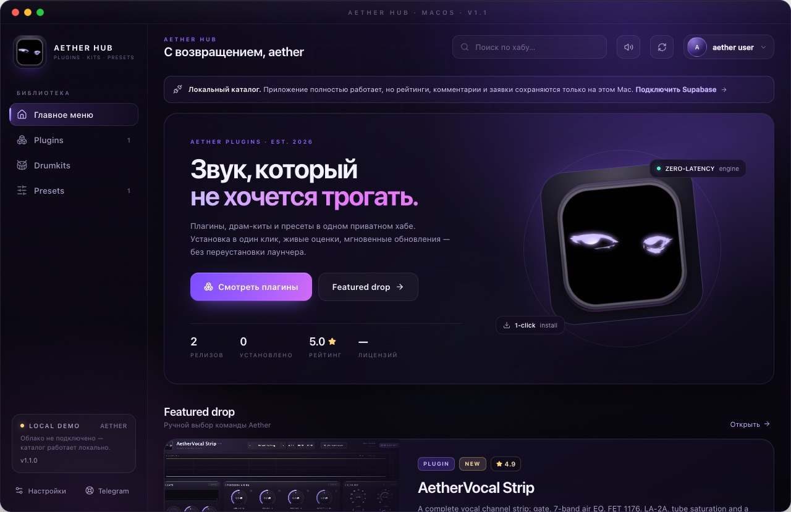

## Скриншоты

| Главное меню | Релиз и лицензия |
|---|---|
|  | 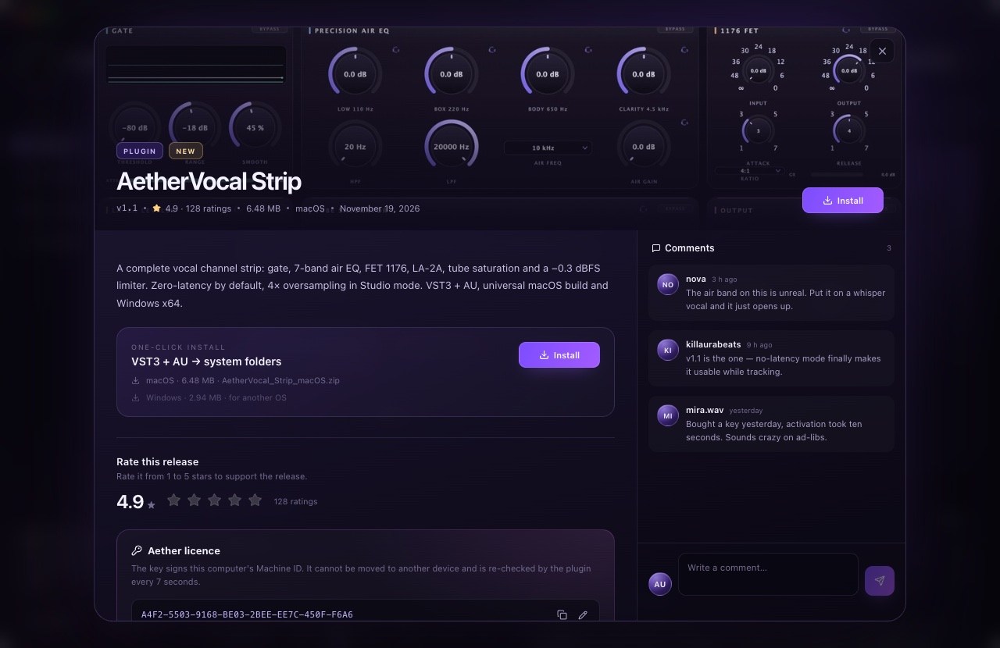 |

| Admin Studio | Keygen & Requests |
|---|---|
| 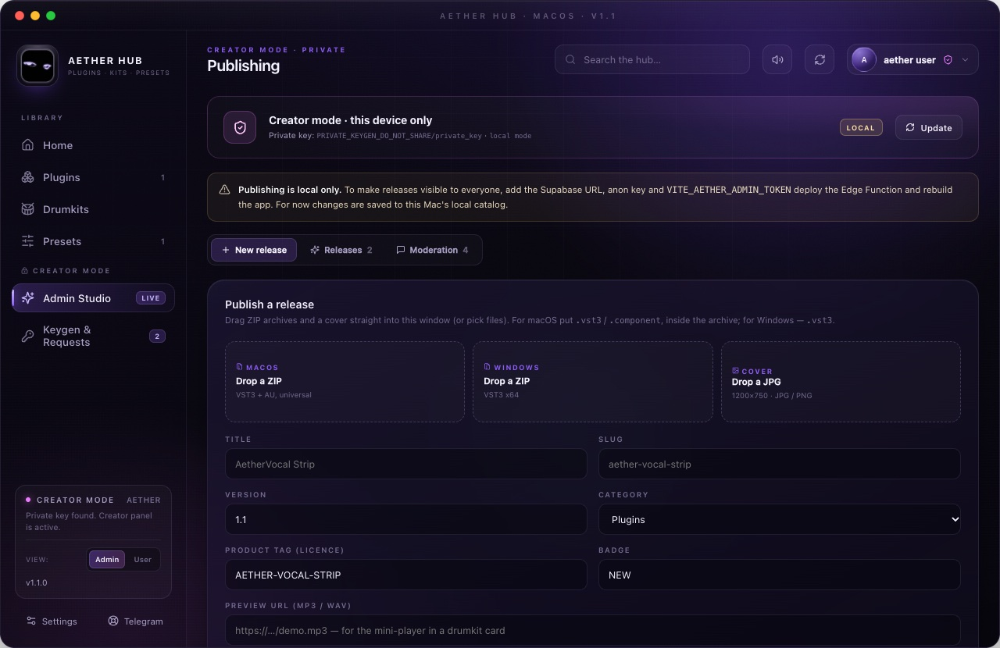 | 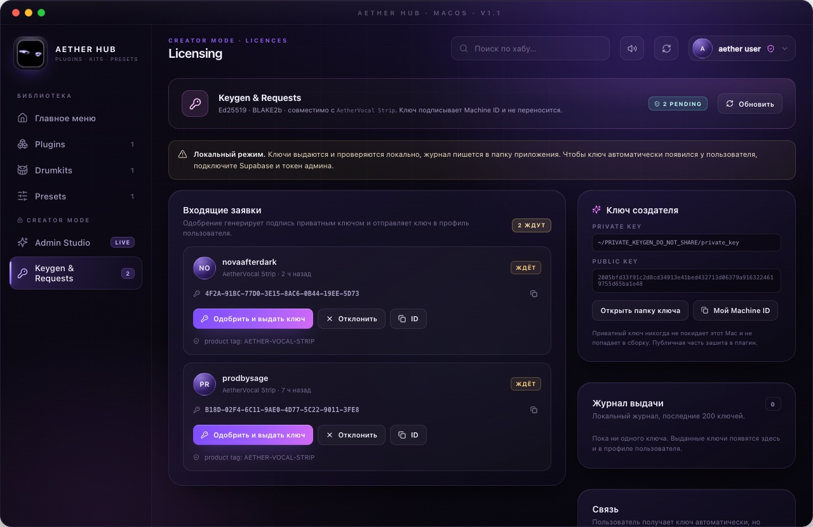 |

| Заставка | Профиль |
|---|---|
| 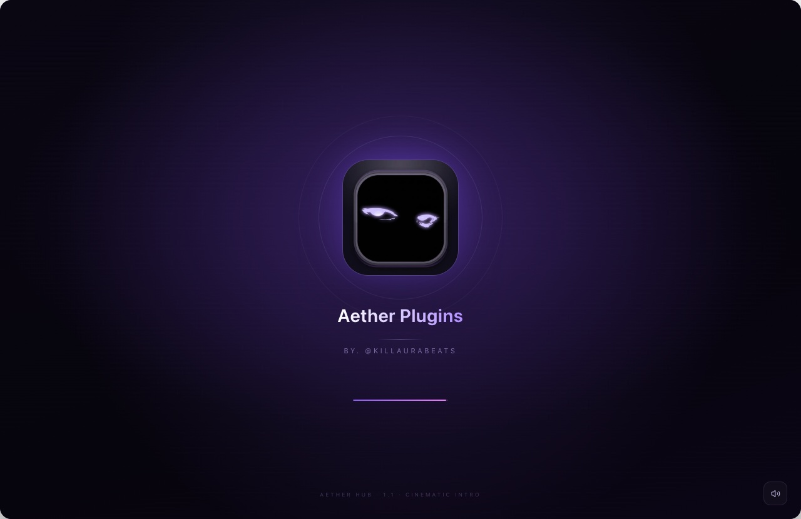 | 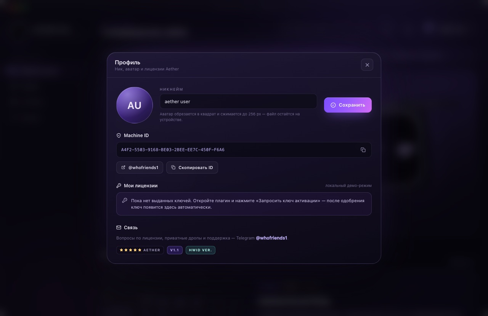 |

| Drumkits SOON | Presets SOON |
|---|---|
| 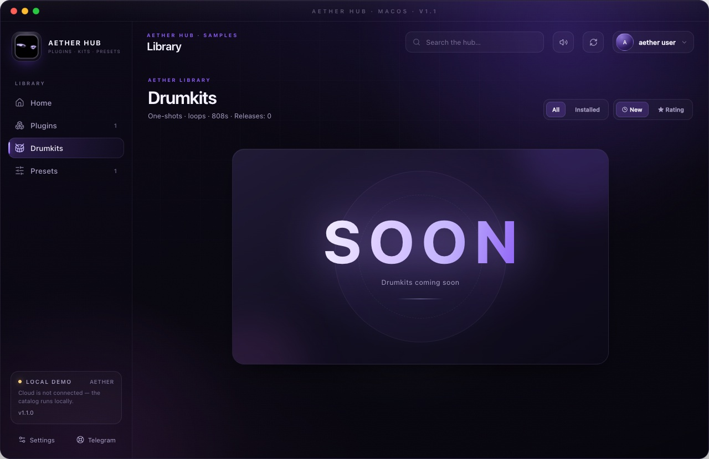 | 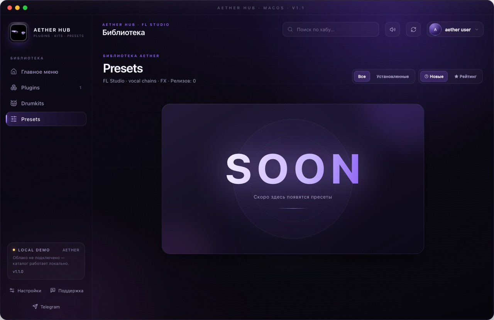 |

| Support | User view |
|---|---|
| 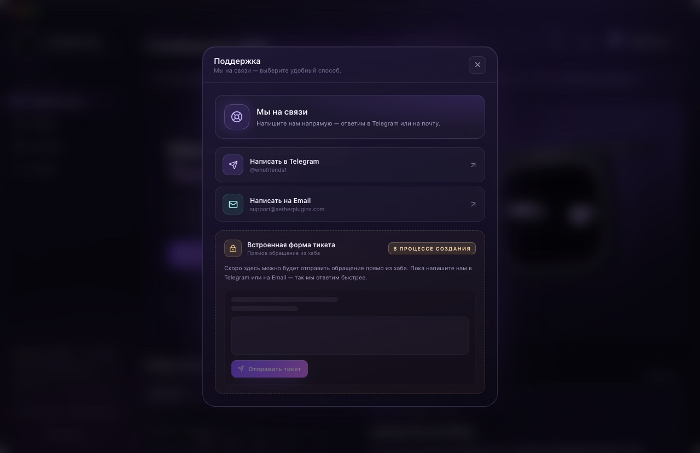 | 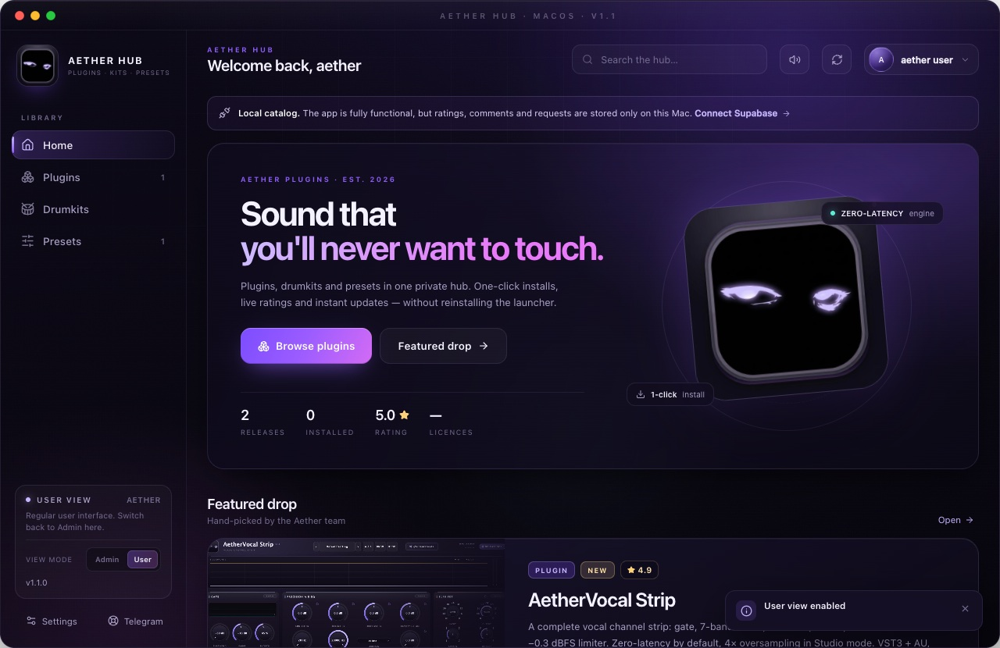 |

| Ticket chat | — |
|---|---|
| 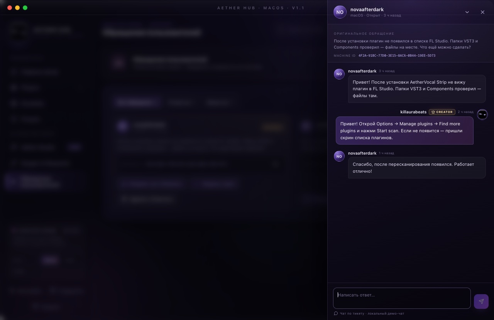 | |

| English UI | — |
|---|---|
| 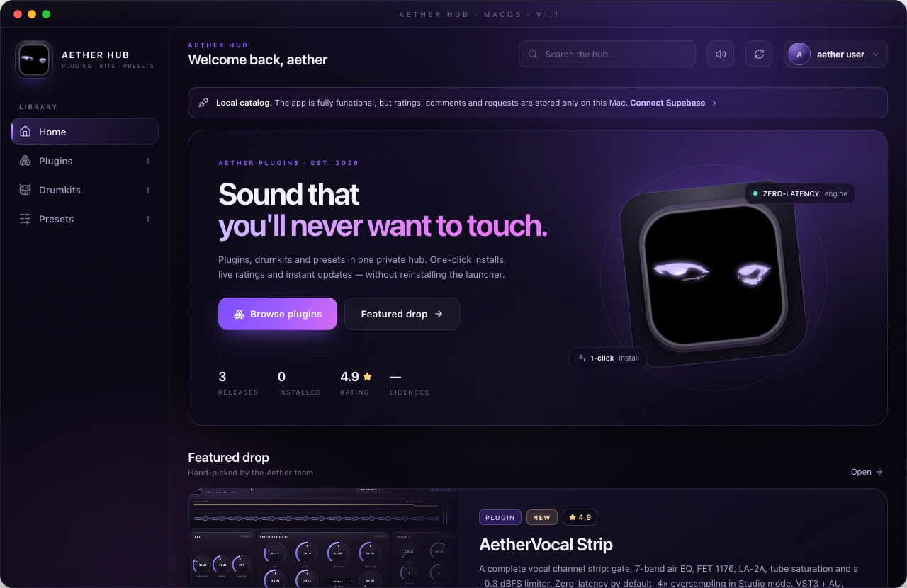 | |

| Настройки (RU) | Settings (EN) | Avatar Cropper |
|---|---|---|
| 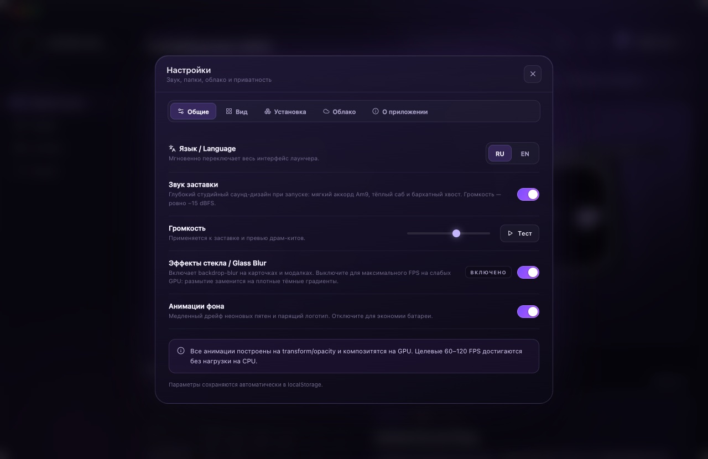 | 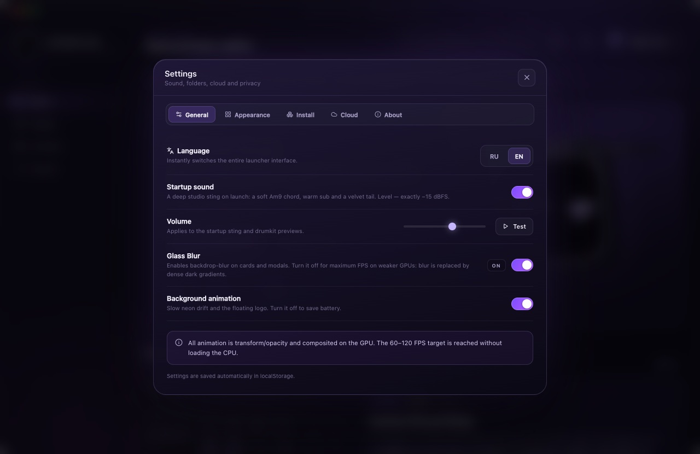 | 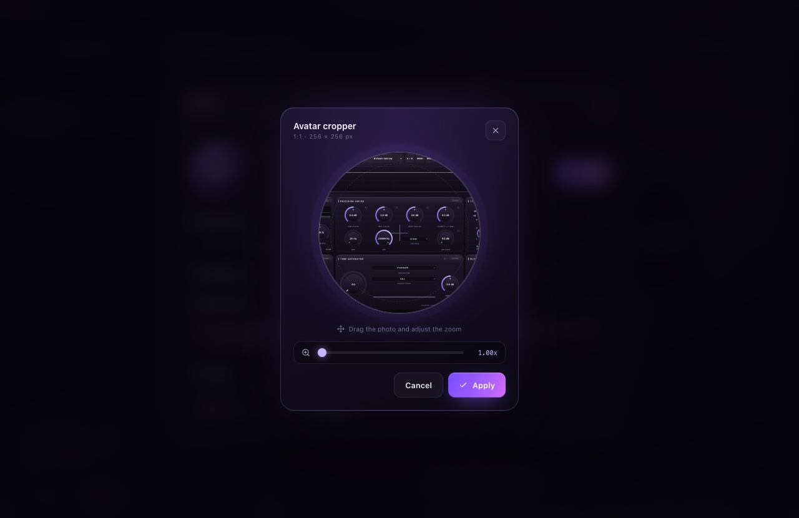 |

## Что внутри

- **Кинематографичная заставка** (~1.8 с): логотип с мягким свечением и строки
  `Aether Plugins` / `by. @killaurabeats`. Новый `startup.wav` — бархатный
  аккорд **Am9** на чистых синусоидах: low-pass 2.2 kHz, атака 180 ms,
  затухание 1.6 s, тёмный convolution-reverb и пик ровно **−15 dBFS**.
  Мягко в наушниках, без FM-обертонов и резких высоких частот. Тумблер — в
  настройках.
- **Библиотека**: `Plugins`, `Drumkits`, `Presets` с поиском, фильтрами,
  рейтингами, обложками, точным весом файла и статусом установки.
- **BETA-уровень и ранний доступ**: релизы с `tier = beta` открываются только
  для HWID с активированным Beta-инвайтом. Бейджи **BETA / BETA TESTER** и замок
  раннего доступа светятся фирменным золотым неоном, а BETA-лицензия пишется на
  диск автоматически при установке.
- **Samples & Loops от комьюнити**: лупы и ваншоты с BPM/тональностью,
  встроенным waveform-плеером, лайками и нативным drag & drop сразу на плейлист
  FL Studio. Загрузки проходят премодерацию в Admin Studio.
- **Колокольчик уведомлений**: свежие релизы, BETA-обновления, статусы
  PRO-лицензий и модерации сэмплов, со счётчиком непрочитанных.
- **Zero-Copy лицензии PRO**: после одобрения заявки кнопка превращается в
  «Активировать и установить», а `license.aether` сам записывается в системную
  папку плагина.
- **Анти-дубликаты VST3 на Windows**: установщик сверяет и
  `%LOCALAPPDATA%\Programs\Common\VST3`, и `C:\Program Files\Common Files\VST3`,
  удаляя старые конфликтующие копии, которые мешают FL Studio.
- **Деплой плагинов одной командой**: `scripts/deploy-plugin.sh` (и копия в
  `~/Desktop/OpenCode Project/AetherPlugins/`) упаковывает macOS/Windows билды,
  загружает их в Supabase Storage и обновляет запись в `releases`.
- **Умная установка в 1 клик**: ZIP под macOS/Windows, распаковка и раскладка
  `.vst3` / `.component` по системным папкам, пресетов — в FL Studio,
  драм-китов — в выбранную папку. Обновление и удаление из карточки релиза.
- **Полная локализация RU / EN**: весь интерфейс — навигация, заголовки,
  кнопки, фильтры, профиль, отзывы, настройки и админка — мгновенно
  переключается на чистый английский. Выбор сохраняется в `localStorage`.
- **Настройки под железо**: `Glass Blur` ON/OFF. При выключении на корень
  вешается класс `.no-blur`, все `backdrop-filter` отключаются, а стеклянные
  поверхности заменяются плотными градиентами `rgba(16, 13, 30, 0.96)` —
  интерфейс летает на слабых Windows-ноутбуках и старых Mac.
- **Оценки 1–5 ★ и живые комментарии** с аватарками и удалением спама админом.
- **Профиль**: ник, круглая аватарка с интерактивным cropper'ом (перетаскивание,
  Zoom 1–3×, Apply → 256×256 px), Machine ID, лицензии и статусы заявок.
- **Лицензии**: точный HWID-алгоритм AetherVocal Strip, заявка из хаба,
  одобрение в админке, автоматическая выдача `AETHER-...` ключа и копирование
  в один клик. Если плагин показывает другой Machine ID (некоторые сборки
  macOS маскируют MAC для фоновых процессов), его можно вставить карандашом
  в карточке лицензии или в профиле — заявка и ключ привяжутся к нему.
- **Creator mode** (только на MacBook владельца): публикация, live-редактирование,
  удаление релизов, модерация комментариев, генератор ключей. В нижнем блоке
  сайдбара есть переключатель **Admin / User view**: режим «Юзер» прячет
  админ-вкладки, правки и модерацию, чтобы проверить хаб глазами пользователя.
- **Drumkits / Presets SOON**: демо-кит и демо-пресет убраны из каталога.
  Пока категория пуста, по центру показывается стеклянная неоновая плашка
  **SOON**; она исчезает после первой публикации и возвращается, если удалить
  все релизы категории.
- **Поддержка**: кнопка в сайдбаре открывает полностью закрытый тизер —
  стеклянную плашку с замком и крупным бейджем **В процессе создания** /
  **In development**, без активных форм и контактных ссылок.
  В Creator Mode добавлена вкладка **Support Tickets** с тикетами из облачной
  таблицы `support_tickets` (статусы, Machine ID, закрытие, удаление, очистка)
  и **живым чатом по каждому тикету**. Сообщения создателя подписаны бейджем
  **👑 Creator** и логотипом хаба, сообщения пользователя — его аватаром и ником.
- **Двуязычные описания**: `description_ru` / `description_en` в релизах и
  форме Admin Studio; карточки и страница плагина показывают текст выбранного
  языка.
- **Выборочная установка плагинов**: отдельные карточки macOS (VST3 + AU) и
  Windows (VST3). Для текущей ОС — установка, для другой — скачивание ZIP в
  `~/Downloads/Aether Hub`; «Удалить» появляется только после установки.
- **Облако без переустановки**: каталог, релизы, рейтинги, комментарии и заявки
  подтягиваются при каждом запуске и по кнопке обновления.

## Стек и структура

```
Aether Hub v1.3.8/
├─ src/                    React + TypeScript UI
│  ├─ components/          Splash, Sidebar, ReleaseCard, Admin Studio, модалки
│  ├─ lib/
│  │  ├─ cloud.ts          Supabase REST/RPC + локальный fallback
│  │  ├─ store.tsx         состояние приложения
│  │  ├─ i18n.ts           словарь RU → EN и t()
│  │  ├─ sound.ts          startup.wav
│  │  └─ format.ts         даты/время по языку
│  └─ styles.css           фирменная тема, glassmorphism
├─ src-tauri/
│  ├─ src/
│  │  ├─ hwid.rs           Machine ID, совместимый с плагином
│  │  ├─ keygen.rs         Ed25519 (Monocypher/BLAKE2b) ключи
│  │  ├─ admin.rs          поиск приватного ключа
│  │  ├─ install.rs        загрузка, ZIP, установка
│  │  └─ lib.rs            Tauri-команды
│  ├─ resources/releases/  демо-архивы (macOS + Windows + kits)
│  ├─ vendor/monocypher/   криптография, совместимая с плагином
│  └─ dmg/background.png   фон установщика macOS
├─ supabase/
│  ├─ schema.sql           таблицы, RLS, RPC, storage
│  └─ functions/aether-admin/index.ts
├─ tools/                  генераторы ассетов, звука и скриншотов
├─ assets_raw/             исходники иконок и логотипа
└─ .github/workflows/build.yml
```

## Требования

- macOS 11+ (Apple Silicon или Intel) или Windows 10/11 x64
- Node.js 20+ (проверено на 22)
- Rust stable + Cargo
- macOS: Xcode Command Line Tools
- Windows: Microsoft C++ Build Tools, WebView2 (ставится Tauri/NSIS), WiX/NSIS
  скачиваются автоматически при сборке

## Быстрый старт

```bash
npm ci
npm run tauri:dev       # дев-режим с горячей перезагрузкой
npm run tauri:build     # релизная сборка под текущую ОС
```

Только фронтенд в браузере (без нативных функций):

```bash
npm run dev             # http://localhost:1420
# ?previewAdmin=1 — посмотреть админ-интерфейс (только в браузере)
```

## Сборка macOS

```bash
npm run tauri:build -- --bundles app,dmg
```

Результат:

```
src-tauri/target/release/bundle/macos/Aether Hub.app
src-tauri/target/release/bundle/dmg/Aether Hub_1.2.0_aarch64.dmg
```

Универсальная сборка (arm64 + x86_64):

```bash
rustup target add aarch64-apple-darwin x86_64-apple-darwin
npm run tauri:build -- --target universal-apple-darwin --bundles app,dmg
```

Готовые размеры этой сборки: **~19 МБ `.app`** и **~17 МБ `.dmg`** (без
искусственного раздувания; при добавлении контента растут только ресурсы).

> Если Tauri не может собрать DMG из-за запроса доступа к Finder
> (Privacy → Automation), используйте headless-скрипт:
>
> ```bash
> python3 -m pip install --user dmgbuild   # один раз, опционально
> npm run build:mac
> ```
>
> Он собирает `.app` и стилизованный `.dmg` без управления Finder.

Приложение не подписано. При первом запуске: правый клик → **Открыть**, либо

```bash
xattr -dr com.apple.quarantine "/Applications/Aether Hub.app"
```

## Сборка Windows

На Windows:

```powershell
npm ci
npm run tauri build -- --bundles nsis,msi
```

Результат: `src-tauri/target/release/bundle/nsis/*.exe` и
`src-tauri/target/release/bundle/msi/*.msi`.

## Облако Supabase (общее для всех пользователей)

Лаунчер работает и без облака: включается встроенный демо-каталог и
localStorage. Чтобы рейтинги, комментарии и заявки были общими:

1. Создайте бесплатный проект на [supabase.com](https://supabase.com).
2. **SQL Editor** → вставьте `supabase/schema.sql` → **Run**.
   Скрипт создаст таблицы, RLS-политики, RPC-функции и публичный bucket
   `aether-assets`. Повторный запуск безопасен.
3. Задеплойте админ-функцию:

   ```bash
   npm i -g supabase
   supabase login
   supabase link --project-ref <project-ref>
   supabase functions deploy aether-admin --no-verify-jwt
   supabase secrets set ADMIN_TOKEN=$(openssl rand -hex 32)
   ```

4. Скопируйте `.env.example` → `.env`:

   ```env
   VITE_SUPABASE_URL=https://xxxx.supabase.co
   VITE_SUPABASE_ANON_KEY=sb_publishable_...   # или anon JWT
   VITE_AETHER_ADMIN_TOKEN=<тот же ADMIN_TOKEN>
   ```

5. Пересоберите приложение (`npm run tauri:dev` / `npm run tauri:build`).
   Ключи Vite вшиваются в бандл при сборке; каталог после этого обновляется
   из облака при каждом запуске. Новый `sb_publishable_…` ключ поддерживается
   наравне со старым `anon` JWT.

6. Проверьте подключение: **Настройки → Облако → Таблицы и Storage →
   Проверить**. Публичные таблицы — `доступна`, закрытые — `защищена · RPC`;
   строка `aether-assets | не найдена` означает, что `schema.sql` не выполнен.
   Пока в облаке нет опубликованных релизов, хаб показывает демо-каталог и
   подсказывает опубликовать первый релиз в Admin Studio.

> **Важно:** `VITE_AETHER_ADMIN_TOKEN` добавляйте только в свою локальную
> сборку. Публичные сборки (GitHub Actions) собираются без него — у них нет
> прав на публикацию, модерацию и выдачу ключей.

Подробная инструкция, схема таблиц и ротация токена: [`docs/CLOUD_SETUP.md`](docs/CLOUD_SETUP.md).

### Демо-режим

Если `.env` отсутствует:

- каталог берётся из встроенного набора (реальный AetherVocal Strip для macOS
  и Windows; Drumkits и Presets начинаются с плашки SOON);
- оценки/комментарии/заявки хранятся в `localStorage`;
- установка, HWID, лицензии, Admin Studio и keygen продолжают работать локально.

## Auto-update (v1.2+)

Лаунчер проверяет обновления через `tauri-plugin-updater`:

```
https://github.com/killaurabeats/aether-hub-releases/releases/latest/download/latest.json
```

Релизные сборки подписываются ключом Tauri. В GitHub Actions должны быть
добавлены секреты:

- `TAURI_SIGNING_PRIVATE_KEY` — содержимое
  `~/PRIVATE_KEYGEN_DO_NOT_SHARE/tauri_updater.key`;
- `TAURI_SIGNING_PRIVATE_KEY_PASSWORD` — пароль из
  `~/PRIVATE_KEYGEN_DO_NOT_SHARE/tauri_updater.password`.

Для автоматической публикации в публичный репозиторий релизов добавьте
`RELEASES_TOKEN` (fine-grained PAT с правом Contents: Read and write только
на `killaurabeats/aether-hub-releases`). Без него workflow всё равно собирает
подписанные бандлы и `latest.json`, но публикацию нужно сделать вручную.

## FREE / PRO и Beta Tester

- `releases.tier` = `free` / `pro`; FREE-плагины получают лицензию
  автоматически при установке и не показывают запрос ключа.
- `beta_invites` — одноразовые коды `AETHER-BETA-XXXX`; активация
  привязывает код к HWID и включает бейдж BETA TESTER в профиле.
- Управление обоими разделами находится в **Admin Studio**.

## Creator mode (только на вашем Mac)

При старте лаунчер ищет локальный секретный файл:

```
~/PRIVATE_KEYGEN_DO_NOT_SHARE/private_key
~/PRIVATE_KEYGEN_DO_NOT_SHARE/private_key.txt
~/admin.secret
~/Library/Application Support/com.aetherhub.launcher/admin.secret
```

Формат — 128 hex-символов (64 байта `seed || public`, как в
`PRIVATE_KEYGEN_DO_NOT_SHARE/private_key.txt`), 64 hex (seed) или JSON
`{"privateKey":"..."}`. `admin.secret` также может содержать путь к файлу.

Если файла нет — вкладки `Admin Studio` и `Keygen & Requests` **полностью
скрыты**; у пользователя нет ни кнопки, ни маршрута к ним.

### Admin Mode на публичной сборке (например, Windows ПК)

Публичный установщик по-прежнему собирается с пустым `adminToken`. На своём
доверенном ПК админку можно открыть без пересборки:

1. **Настройки → О приложении**.
2. Пять быстрых кликов по номеру версии `v1.2.0` (интервал меньше секунды).
3. В скрытом поле **«Ключ создателя (Admin Token)»** вставить свой
   `ADMIN_TOKEN` и нажать **«Включить админ-режим»**.

Токен проверяется через Edge Function и сохраняется только в `localStorage`
этого устройства. Сразу появляются `Admin Studio` и `Support Tickets`.
`Keygen & Requests` активируется дополнительно, если на этом ПК лежит
приватный ключ в `PRIVATE_KEYGEN_DO_NOT_SHARE/private_key`.

На этом Mac ключ уже установлен:

```bash
mkdir -p ~/PRIVATE_KEYGEN_DO_NOT_SHARE
cp "/path/to/private_key.txt" ~/PRIVATE_KEYGEN_DO_NOT_SHARE/private_key
chmod 600 ~/PRIVATE_KEYGEN_DO_NOT_SHARE/private_key
```

### Admin Studio

- публикация ZIP для macOS/Windows и обложки (drag & drop или выбор файла);
- название, slug, версия, описание, категория, product tag, бейдж, featured;
- загрузка файлов напрямую в Supabase Storage через signed upload URL;
- live-редактирование (карандаш) и удаление релиза — изменения сразу в облаке;
- модерация комментариев.

Без облака публикация пишется в локальный демо-каталог, а файлы ставятся по
пути `local:/...` — удобно для теста.

### Keygen & Requests

- входящие заявки: аватар, ник, плагин, Machine ID, время;
- **Одобрить и выдать ключ** → Rust подписывает HWID приватным ключом,
  ключ уходит в облако, автоматически копируется в буфер и попадает в журнал;
- журнал последних 200 ключей хранится в
  `~/Library/Application Support/com.aetherhub.launcher/issued_licenses.jsonl`;
- публичный ключ и путь к приватному отображаются в панели.

### Совместимость ключей и HWID

Реализация побайтово совпадает с `AetherVocal Strip`:

- Machine ID = `SHA-256("AetherVocalStrip.HWID.v1|uuid=…|mac=…|device=…")`,
  первые 16 байт, 32 uppercase hex;
- подпись — Monocypher EdDSA (Ed25519 с BLAKE2b), сообщение
  `AETHER-VOCAL-STRIP|v1|<32 hex>`;
- ключ — `AETHER-` + base32(версия 1 + 64-байтовая подпись), группы по 4.

Проверка на этом Mac:

```bash
cd src-tauri
cargo test --lib -- --nocapture
# MACHINE ID: XXXX-XXXX-…  (совпадает с --print-machine-id плагина)
# LICENCE KEY: AETHER-…    (побайтово совпадает с ./aether-keygen)
```

Подробности: [`docs/KEYGEN.md`](docs/KEYGEN.md).

## Куда ставятся файлы

| Категория | macOS | Windows |
|---|---|---|
| Плагины | `~/Library/Audio/Plug-Ins/VST3`, `.../Components` | `%COMMONPROGRAMFILES%\VST3` (fallback `%LOCALAPPDATA%\Programs\Common\VST3`) |
| Пресеты | `~/Documents/Image-Line/FL Studio/Presets/Aether Plugins` | `%USERPROFILE%\Documents\Image-Line\FL Studio\Presets\Aether Plugins` |
| Драм-киты | `~/Documents/Aether Hub/Drumkits` (можно изменить) | `%USERPROFILE%\Documents\Aether Hub\Drumkits` |

Пути пресетов и китов меняются в **Настройки → Установка**. Плагины
устанавливаются без прав администратора: на Windows при ошибке записи в
`Program Files` автоматически используется пользовательская папка VST3.

### Выборочная установка

На странице плагина доступны две платформы:

- **macOS** — `VST3 + AU`, установка в `~/Library/Audio/Plug-Ins/...`;
- **Windows** — `VST3`, установка в системные папки Windows.

Кнопка текущей ОС устанавливает плагин, кнопка другой ОС скачивает ZIP в
`~/Downloads/Aether Hub`. Кнопка удаления в блоке установленного релиза
появляется только после успешной установки.

## GitHub Actions

Workflow `.github/workflows/build.yml` собирает macOS (universal `.app` + `.dmg`)
и Windows (`.exe` NSIS + `.msi`) на каждый push/tag/PR и вручную.

1. Залейте проект в GitHub.
2. **Settings → Secrets and variables → Actions** добавьте (опционально):
   - `VITE_SUPABASE_URL`
   - `VITE_SUPABASE_ANON_KEY`

   Если секреты не заданы, workflow подставляет публичный URL и publishable
   ключ проекта Aether Hub, поэтому Windows-установщик сразу собирается
   подключённым к облаку.
3. Запустите **Actions → Build desktop apps → Run workflow**.
4. Готовые файлы — в артефактах `aether-hub-macos` / `aether-hub-windows`.

Токен админа в CI не передаётся намеренно. Для релизов можно добавить
подпись Apple/Windows — см. документацию Tauri.

## Производительность

- анимации только `transform`/`opacity`, GPU-композитинг, 60–120 FPS;
- фон — радиальные градиенты и медленный дрейф, без покадрового JS;
- `backdrop-filter` только на карточках и всплывающих окнах; **Glass Blur = OFF**
  (`.no-blur`) убирает все размытия и заменяет их плотными поверхностями;
  отдельный тумблер отключает анимации фона;
- Rust-установщик работает асинхронно, прогресс приходит событиями;
- RAM в простое — WebView + небольшой Rust-процесс; телеметрии нет.

## Скрипты

| Команда | Назначение |
|---|---|
| `npm run dev` | Vite-фронтенд |
| `npm run tauri:dev` | приложение с нативными командами |
| `npm run tauri:build` | релизная сборка |
| `npm run icons` | перегенерировать `.icns`/`.ico` из `assets_raw/icon-master.png` |
| `python3 tools/make_assets.py` | иконка, логотип, обложки, фон DMG |
| `python3 tools/make_audio.py` | `startup.wav` (−15 dBFS) и демо-сэмплы |
| `python3 tools/make_audio.py --sound-only` | только новый звук запуска |
| `node tools/shoot.mjs <url> <out>` | скриншот 1280×830 для QA |

## Окно и прокрутка

- окно **resizable** и **maximizable**; на macOS зелёная кнопка в кастомном
  заголовке переводит лаунчер в настоящий полноэкранный режим (`setFullscreen`),
  а не просто растягивает окно;
- **F11** на Windows и **⌃⌘F** на macOS тоже переключают fullscreen;
- правая рабочая область — отдельный scroll-контейнер (`overflow-y: auto`,
  `min-height: 0`, нижний отступ 48 px), поэтому Home, Plugins, Drumkits,
  Presets, Admin Studio и Keygen листаются колесиком и трекпадом;
- модалки (включая Настройки) имеют собственный scroll с тонким скроллбаром
  **6 px**: тёмно-фиолетовый трек и мягкий лавандовый бегунок;
- минимальный размер окна — 900 × 600, дальше срабатывает адаптивная раскладка.

## Настройки

Иконка шестерёнки в левом нижнем углу открывает окно с вкладками
**Общие / Вид / Установка / Облако / О приложении**:

- **Язык / Language** — RU / EN для всего интерфейса;
- **Звук заставки** — ON/OFF и громкость, тест без перезапуска;
- **Эффекты стекла / Glass Blur** — ON/OFF, класс `.no-blur`, плотные
  поверхности, 120 FPS на слабых GPU;
- **Анимации фона** — дрейф неона и парящий логотип;
- пути установки, сброс демо-каталога, состояние облака, Admin API и
  инструкция Supabase.

Все параметры сохраняются в `localStorage` и применяются сразу — без
перезапуска лаунчера.

## Решение проблем

**Админ-вкладок нет.** Проверьте путь ключа и права (`chmod 600`), перезапустите
приложение. Файл должен содержать 128 hex-символов.

**Звук заставки не играет.** macOS/Windows могут блокировать автоплей до первого
клика; кликните по окну или включите звук в настройках.

**Gatekeeper / SmartScreen.** Сборки не подписаны: правый клик → Open,
либо подпишите сертификатом.

**Плагин не появился в FL Studio.** Options → Manage plugins → Find more plugins.
Проверьте папки из таблицы выше.

**Комментарии/заявки не синхронизируются.** Убедитесь, что `schema.sql` выполнен,
`.env` заполнен и приложение пересобрано. Проверьте логи Edge Function в Supabase.

**Ключ не появился в профиле.** Профиль опрашивает облако каждые 45 секунд
(и при фокусе окна). Убедитесь, что заявка одобрена и `ADMIN_TOKEN` совпадает.

**Machine ID в терминале отличается от приложения.** На некоторых сборках
macOS сетевые MAC-адреса маскируются для процессов, запущенных из терминала.
Берите Machine ID из окна плагина или лаунчера. Если ID всё равно отличается,
нажмите карандаш рядом с Machine ID в карточке плагина и вставьте значение из
окна активации — заявка, ключ и профиль будут привязаны к нему.

## Безопасность

- приватный ключ лицензий никогда не входит в сборку и не передаётся в CI;
- админ-операции идут через Edge Function с секретным токеном и service role;
- RLS: публично читаются только `releases` и `comments`; Machine ID, рейтинги,
  заявки и ключи доступны только через SECURITY DEFINER RPC по своему HWID;
- загрузки в Storage — только по signed URL, выданным админ-функцией;
- телеметрии нет; аватар сжимается локально до 256 px.

## Лицензии

Код лаунчера — ваш. Monocypher — BSD-2-Clause / CC0. Шрифты — системные.
Демо-аудио и обложки сгенерированы скриптами в `tools/`. AetherVocal Strip
и его сборки принадлежат автору проекта.
